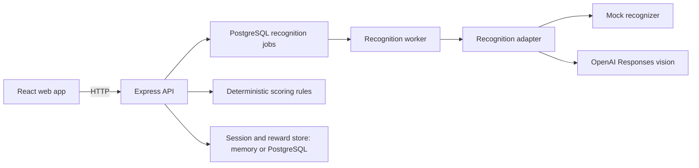

# EcoScan architecture (MVP)

## What we are building

EcoScan helps someone understand the *estimated production footprint* of clothing visible in a photo and explore one possible lower-impact choice. A photo cannot establish the garment's exact supply chain, material, or whether a new purchase was actually avoided. The interface must say so.

The first complete user journey is:

1. Upload an image or capture one with the device camera.
2. Receive suggested clothing categories from a recognizer.
3. Add, remove, or correct the suggested items.
4. Choose whether wearing these items again would replace a planned new purchase.
5. See item estimates, a total, a clearly labelled *scenario* for potential avoided production, demo points, and available or locked offers.

## System shape



This is one deployable backend (a modular monolith), not microservices. `web/` handles interaction, `backend/` owns rules and state, `api/index.ts` adapts it to a Vercel Function, and `shared/` holds request/response schemas used by both. The recognition adapter returns item *suggestions only*. It never decides carbon or points.

The API creates an opaque, HTTP-only, same-site anonymous session cookie. In PostgreSQL mode, a user can sign up and attach that session to an account; later logins use a separate revocable HTTP-only cookie to resolve the same account-owned balance. Anonymous sessions expire after inactivity, while account-owned balances persist. The browser does not choose or edit its point balance. The React UI uses a Vite `/api` proxy to Express in development. Its pages are described in `web/README.md`. `GET /api/health` is a process liveness check; `GET /api/ready` checks the PostgreSQL connection when one is configured.

```text
web/src/pages/               home, scan, results, rewards, and account pages
web/src/hooks/               scan workflow and rewards state
web/src/components/          camera, navigation, and home sections
web/src/lib/api.ts           backend client
backend/src/routes/             HTTP upload, confirmation, latest result, offers, auth
backend/src/services/           analysis, confirmation, and offer workflows; storage contract
backend/src/services/vision/    mock and optional provider adapters
backend/src/domain/             carbon catalogue, scenario, points, offers
backend/src/store/              in-memory and PostgreSQL session adapters
shared/src/                 request and response schemas
```

## Service separation now implemented

Routes handle HTTP and delegate workflows to `AnalysisService`, `ScanService`, and `OfferService`. Services call domain rules, the recognition adapter, and the `EcoScanStore` contract. The chosen store owns atomic state changes; routes cannot mutate balances directly. Cookie handling lives in HTTP middleware, and `app.ts` connects the components and maps application errors to HTTP responses. See [SERVICE_LAYER.md](SERVICE_LAYER.md) for a simple walkthrough and file map.

These are internal code boundaries within one backend codebase. The storage contract is asynchronous. PostgreSQL mode uses transactions and row locks for rewards and confirmation retries. The long-running deployment queues recognition and a worker completes it. The Vercel/Neon deployment recognizes within the upload request because it has no continuous worker; it keeps PostgreSQL for accounts, sessions, results, limits, and rewards. PostgreSQL also coordinates upload rate and concurrency limits across copies.

## API contract

All responses use JSON except the image upload request. Errors use `{ "error": { "code": "...", "message": "..." } }`.

### `POST /api/analyses`

Multipart field: `image`. Accept JPEG, PNG, or WebP up to 5 MB. Check the file content as well as the reported MIME type. Return `400` for a missing file, `415` for unsupported content, and `413` for an oversized file. The Docker deployment with PostgreSQL queues recognition and returns `202` with an analysis ID; `GET /api/analyses/:analysisId` reports `queued`, `processing`, `ready`, `failed`, or `confirmed`. The worker deletes the private image bytes after success or final failure. The Vercel deployment uses PostgreSQL but processes recognition within the request and returns suggestions directly with `200`, as does the in-memory demo.

```json
{
  "analysisId": "demo-id",
  "recognitionMode": "mock",
  "suggestions": [{ "id": "item-1", "category": "tshirt" }],
  "needsReview": true
}
```

`recognitionMode` is shown in the UI. The mock always suggests one T-shirt, regardless of image content; it is a clearly labelled demonstration and requires user review. Setting `VISION_PROVIDER=openai` selects the OpenAI Responses API. The image is sent as a base64 data URL and the response is constrained to supported clothing categories. The provider suggests categories only; the server computes all carbon and reward numbers. In PostgreSQL mode, repeated provider failure marks the queued analysis `failed` and awards no points. In-memory mode returns `503 VISION_UNAVAILABLE`. Do not show an invented confidence percentage. The MVP validates MIME type and common file signatures; a production image decoder would provide stronger corruption checks.

### `POST /api/scans/confirm`

The user submits corrected item categories and the comparison choice. The API validates the categories, computes every number with versioned rules, records demo points in the chosen store, and saves the response in a confirmed scan record. It also saves the latest estimate on the session so the Results page can reopen it after a refresh. A repeated equivalent confirmation returns that original response without awarding again. Equivalence uses totals per category and the comparison choice, so row ordering or splitting a quantity into multiple rows does not change it. A changed confirmation returns `409 CONFIRMATION_CONFLICT`. The replayed balance is the original snapshot; use `GET /api/offers` for the current balance.

```json
{
  "analysisId": "demo-id",
  "items": [{ "category": "tshirt", "quantity": 1 }],
  "replacesPlannedNewPurchase": true
}
```

```json
{
  "items": [{ "category": "tshirt", "quantity": 1, "estimatedProductionKgCo2e": 5 }],
  "totalEstimatedProductionKgCo2e": 5,
  "scenarioPotentialAvoidedKgCo2e": 2.5,
  "demoPointsAwarded": 25,
  "demoPointsBalance": 25,
  "assumptionsVersion": "demo-v1"
}
```

### `GET /api/scans/latest`

Returns `{ "result": null }` before the first confirmation, or the latest confirmed estimate for the current anonymous session or signed-in account. The snapshot contains no photo. The short-lived analysis record is still used for safe confirmation retries; the latest snapshot remains until the anonymous session expires or the account is deleted.

### `GET /api/offers`

Returns the current `demoPointsBalance` and an `offers` array with `id`, `title`, `description`, `pointsCost`, `canRedeem`, and `redeemed`. An empty balance still returns the offer catalogue. The three offers are fictitious examples: a repair kit (25 points), a swap pass (60), and a secondhand voucher (100).

### `POST /api/offers/:offerId/redeem`

Deducts the selected offer's actual point cost once and records a demo redemption. Returns `409` when points are insufficient or the offer was already redeemed, and `404` for an unknown offer. No real discount code is issued.

The confirmation endpoint returns `400` for invalid items or comparison input, `404` for an unknown, removed, or different-session analysis, `410` for an expired review while its expiry record is retained, and `409` for a conflicting confirmation. The server ignores client-submitted point balances or offer costs; it computes them itself.

## Reliability controls now implemented

See [BACKEND_RELIABILITY.md](BACKEND_RELIABILITY.md) for the API behavior, configuration, and implementation map. The upload path checks an IP token bucket, a process-wide concurrency limit, and session storage capacity before buffering the image. Scan records move through `queued`, `processing`, `awaiting_review`, `confirmed`, `failed`, and `expired` states in PostgreSQL mode. Cleanup runs periodically and on access; confirmed results support safe retries for a bounded period. Every response carries a generated `X-Request-ID`, with safe structured request logs.

With PostgreSQL mode, the latest confirmed estimate, balances, and redemptions are durable and reward updates coordinate across backend processes. Upload and worker limits are shared through PostgreSQL. The frontend is implemented and OpenAI recognition has been checked locally; a production frontend deployment and repeatable provider check in the release process remain outstanding.

## Carbon and reward assumptions

Use an in-memory catalogue matching the challenge's illustrative examples: T-shirt 5, jeans 10, jacket 15, shoes 8 kg CO2e for production of a comparable new item. These are **demo placeholders**, not scientifically validated product footprints. Show the assumption and version in the result and README. Add categories only when we can describe their assumptions.

For the optional comparison, `scenarioPotentialAvoidedKgCo2e = totalEstimatedProductionKgCo2e × 0.5` when the user says this wear would replace a planned new purchase; otherwise it is zero. The 0.5 displacement factor is an explicit demo assumption, not a measured saving. `demoPointsAwarded = round(scenarioPotentialAvoidedKgCo2e × 10)`. Points are an engagement mechanic, not a carbon credit. The UI must never label the scenario as carbon *actually saved*.

## Decisions and tradeoffs

| Decision | Benefit | Cost or limit |
| --- | --- | --- |
| User reviews recognition | A wrong AI guess cannot silently become a score | Adds one interaction |
| Deterministic, versioned catalogue | Explainable and testable results | Coarse estimates until better data is available |
| Explicit comparison question | Avoids claiming every scan saved emissions | Some scans earn zero points |
| In-memory demo sessions | Matches the challenge and is easy to run | State resets on restart and is unsuitable for real rewards |
| Temporary image bytes in PostgreSQL | A worker can read an image after the upload request ends | More database write load; delete bytes after completion or expiry |
| Recognition adapter with explicit mock/OpenAI modes | Works without a key for local development and supports real photo recognition when configured | OpenAI calls add latency, cost, and a third-party data transfer; mock results are only a demonstration |

For production, verified rewards would need email verification, recovery flows, a durable transaction ledger, broader abuse checks, and evidence of the claimed action. The present accounts identify returning users but do not make the demo points real-world rewards. More accurate footprints would need sourced lifecycle data for materials, mass, manufacturing region, transport, and uncertainty.

## Implementation sequence

1. Shared category and API schemas, carbon catalogue, scoring function, and focused tests.
2. Upload endpoint with safe validation and an explicit mock recognizer.
3. Confirm endpoint, in-memory demo session, points, and offers with API tests.
4. React upload/camera, review, results, and offers flow.
5. Optional real vision adapter, end-to-end checks, README, and deployment.

The resulting code keeps recognition suggestions separate from deterministic scoring, so a reviewer can inspect an example input and explain each number.
