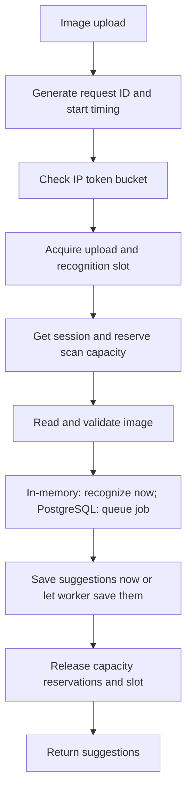

# Backend reliability

This describes implemented behavior. The backend remains one Express application. Development and unit tests use bounded in-memory state; PostgreSQL mode persists sessions, scans, and rewards across application restarts.

## Request flow

Failures after admission also release reservations and slots. Upload parsing has an abort handler. In-memory mode keeps a recognition slot until the recognizer settles, even if the client disconnects, and does not save a result after disconnection. PostgreSQL mode saves a durable job after validating the upload; the worker runs independently of the browser connection. The API entry point sets a 30-second HTTP request-receiving timeout and a 15-second headers timeout. Node enforces these timeouts on its connection checking schedule, not as exact end-to-end deadlines. OpenAI calls have a 30-second SDK timeout and no SDK retry; the worker owns bounded job retries so the shared call counter covers every attempt.

## Scan lifecycle and confirmation contract

Each session owns analysis records. The in-memory adapter uses a map and creates an `awaiting_review` record immediately. PostgreSQL mode creates `queued`, then a worker changes it to `processing` and finally `awaiting_review` or `failed`. A ready review can become `confirmed` or `expired`.

- The first valid `POST /api/scans/confirm` saves the calculated response and updates the balance as one operation. The in-memory adapter does this synchronously; PostgreSQL mode locks the session row and commits both updates in a transaction.
- Repeating the same semantic request for that ID returns HTTP 200 and the original saved response. It never adds points again. Category totals and `replacesPlannedNewPurchase` determine equivalence; input row order does not matter.
- A SHA-256 image hash is stored separately from temporary image bytes. Within a session or account, a hash can create one reward claim; later confirmations receive `duplicate_image` and zero points. The session row lock serializes competing claims.
- Different items or a different comparison choice for a confirmed ID return `409 CONFIRMATION_CONFLICT`.
- A repeated response contains the balance at original confirmation time. Read `GET /api/offers` to refresh the current balance after later scans or redemptions.
- Reviews expire after 15 minutes by default. While an expiry marker remains, confirmation returns `410 ANALYSIS_EXPIRED`.
- Confirmed analysis records are retained for 60 minutes after confirmation to support safe retries. A separate latest-result snapshot remains on the session after that record is removed. Expiry markers are retained for 60 minutes after the review deadline. Removed records return `404 ANALYSIS_NOT_FOUND`; removal never makes their IDs valid again.
- An idle anonymous session expires after 30 minutes, including its points and latest result. In-memory mode also clears them on restart. PostgreSQL account sessions keep the balance and latest result across visits. Requests refresh anonymous-session activity; an admitted upload pins its session until it settles or its database lease expires.
- An analysis ID from another session returns 404. Signed-in users can access only the account session associated with their login.

The scan confirmation contract is described by the schemas in `shared/src/index.ts`. The response shape has not changed. Offer redemption still rejects repeats with `409 ALREADY_REDEEMED`; replaying a confirmation does not repeat a redemption.

## Traffic and storage limits

Upload attempts consume tokens before file parsing, including invalid requests and requests rejected later for capacity. The default token bucket allows a burst of five attempts per IP and restores one token every 12 seconds. A new cookie does not reset the IP allowance. Other endpoints are not subject to this scan limiter.

Express's default `trust proxy: false` is retained: client-supplied forwarding headers cannot override the IP. Behind a reverse proxy, configure trust for the actual deployment topology before public launch; otherwise users may share the proxy's allowance. IP-based limits also affect people sharing a network and are not comprehensive abuse prevention.

The default allows five active uploads. In-memory mode enforces this within one process and includes recognition in those slots. PostgreSQL mode coordinates upload slots across API copies; workers use separate shared recognition slots. Excess uploads fail promptly rather than entering an unbounded upload queue. The upload limit includes files still being received, so it bounds concurrent Multer buffers. Session reservations prevent parallel uploads from bypassing the per-session scan cap; PostgreSQL reservations expire after ten minutes to recover from crashed processes. Full stores reject new work rather than evicting live results and breaking retry guarantees. PostgreSQL stores keyed hashes of client IPs for a shared token bucket, not raw IPs. Behind a reverse proxy, `trust proxy` must still be configured for the actual topology before public launch.

| Response | Meaning |
| --- | --- |
| `429 SCAN_RATE_LIMITED` | Not enough tokens; `Retry-After` gives the next token delay in seconds |
| `429 SCAN_STORAGE_LIMIT` | Session has reached its retained scan capacity |
| `503 SCANNER_BUSY` | All upload/recognition slots are occupied |
| `503 SESSION_CAPACITY` | Session store is full |
| `503 RATE_LIMIT_CAPACITY` | Client limiter map is full |
| `503 VISION_UNAVAILABLE` | In-memory recognition provider failed; no analysis or points were created |
| `503 JOB_QUEUE_FULL` | PostgreSQL queue reached its configured limit |
| `409 ANALYSIS_NOT_READY` | Confirmation arrived before the worker produced suggestions |

Capacity responses include a suggested `Retry-After` delay; it does not guarantee capacity will be free then. Full rate buckets are removed safely because a fresh bucket would grant exactly the same allowance. Session and scan cleanup runs on access and periodically from `server.ts`.

## Settings

Set these optional variables in `backend/.env`. Restart the backend to apply changes. Defaults are initial demo settings, not measured production capacity. All listed values must be positive integers. PostgreSQL mode additionally requires `RATE_LIMIT_HASH_KEY`, a secret of at least 32 characters shared by all API copies.

| Variable | Default | Meaning |
| --- | ---: | --- |
| `SESSION_TTL_MS` | 1800000 | Idle session lifetime: 30 minutes |
| `ANALYSIS_TTL_MS` | 900000 | Review window: 15 minutes |
| `RESULT_RETENTION_MS` | 3600000 | Confirmed result or expiry marker retention: 60 minutes |
| `CLEANUP_INTERVAL_MS` | 60000 | Periodic cleanup interval; maximum 2147483647 |
| `MAX_SESSIONS` | 1000 | Maximum sessions (enforced by the chosen store) |
| `MAX_ANALYSES_PER_SESSION` | 50 | Stored records plus reserved uploads per session |
| `SCAN_RATE_CAPACITY` | 5 | Maximum tokens per IP |
| `SCAN_RATE_REFILL_MS` | 12000 | Time to restore one token |
| `MAX_RATE_CLIENTS` | 5000 | Maximum IP buckets |
| `MAX_CONCURRENT_SCANS` | 5 | Admitted uploads; shared across API copies in PostgreSQL mode |
| `MAX_CONCURRENT_VISION` | 3 | Recognition calls active across worker copies in PostgreSQL mode |
| `MAX_DAILY_VISION_CALLS` | 500 | Calls admitted per PostgreSQL calendar day; not a monetary budget |
| `MAX_QUEUED_JOBS` | 100 | Maximum queued and processing images across all API copies |

## Diagnostic logs

`GET /api/health` checks that the Express process responds. `GET /api/ready` also performs a PostgreSQL `SELECT 1` in database mode; it returns `503 NOT_READY` without database error details if that check fails. This checks API and database availability, not worker progress or OpenAI availability.

`X-Request-ID` is generated by the server for every Express response. Incoming IDs are not trusted. One JSON log entry records completion or client disconnection, with an allowlisted operation name, status, duration, error code when available, recognition duration/outcome, and active scan count. Aborted requests use 499 in the log only. Request IDs link responses to logs.

Logs do not contain request bodies, images, filenames, API keys, cookies, IP addresses, query strings, or raw provider exceptions. Logging failures do not break requests. Recognition failure details are deliberately coarse; more granular provider diagnostics remain future work. There is no metrics dashboard or public metrics endpoint; logs can be aggregated to count failures and examine timings.

## Code map

| File under `backend/src` | Responsibility |
| --- | --- |
| `config.ts` | Defaults and validated environment settings |
| `store/demoSessions.ts` | In-memory session storage and synchronous state changes |
| `store/postgresSessions.ts` | Persistent sessions, database leases, transactional awards/redemptions, and replay |
| `services/scanService.ts` | Confirmation validation, equivalent-request fingerprint, and calculation coordination |
| `services/analysisService.ts` | Recognition workflow and saving review suggestions |
| `services/recognitionJobs.ts` | Persistent queue, private image bytes, leases, retries, and status |
| `services/recognitionWorker.ts` and `worker.ts` | Claim and process recognition jobs in a separate process |
| `services/offerService.ts` | Offer eligibility and redemption coordination |
| `services/ports.ts` | Storage contract used by workflows |
| `services/applicationError.ts` | Application failure codes independent of HTTP |
| `routes/scanRoutes.ts` | HTTP adapter for the confirmation service |
| `middleware/sessionContext.ts` | Session cookie handling |
| `middleware/trafficControl.ts` | Bounded token buckets and admission slots |
| `middleware/requestLogging.ts` | Safe request IDs and structured logs |
| `httpError.ts` | Expected errors with status, code, and optional retry delay |
| `routes/analysisRoutes.ts` | Upload lifecycle and guaranteed release of reservations |
| `app.ts` | Wires controls and translates errors into JSON |
| `server.ts` | Loads settings and owns the periodic cleanup timer |

## Verification and limitations

Run `npm run typecheck` and `npm test` from the project root. Tests exercise the Express API with local recognizers, including simultaneous confirmation, expiry, capacity limits, token refilling, concurrency, and log privacy. Set `TEST_DATABASE_URL` to run the PostgreSQL integration suite against a local test database. Tests do not verify OpenAI availability or recognition accuracy.

PostgreSQL mode shares state, transactional reward updates, duplicate-image claims, upload limits, and worker call limits between backend processes. The API queues recognition and the worker processes it after the request. The daily call counter is deliberately conservative: a crashed worker may consume an allowance without reaching the provider. User-edited items receive estimates but zero points. Self-reported purchase replacement remains unverified demo behavior, and exact hashing cannot detect a visually identical image whose bytes were changed. These controls reduce trivial farming; they do not prove carbon savings or make rewards production-grade.
